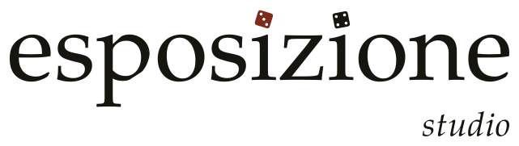

  <picture>
    <source media="(prefers-color-scheme: dark)" srcset="../typst/assets/logo/esposizione-studio-inlinea-negativo.svg">
    
  </picture>

 

# ESPOSIZIONE Studio

ESPOSIZIONE Studio è lo strumento per chi scrive storie con ESPOSIZIONE. Oggi ne esiste il motore, in [`motore/`](motore/README.md):
- il formato dei dati;
- le regole del documento di design 3.0;
- i controlli sulla storia;
- i giocatori automatici;
- il generatore del librogame;
- l'app che si gioca nel browser.

L'editor per chi scrive, costruito sul motore, è la Fase 4 della [roadmap](../ROADMAP.md). Fino ad allora una storia si scrive a mano, nei file di dati.

Lo strumento nasce come **InteractiveWriter**, arrivato in questo repository il 19 agosto 2026. Il suo codice è uscito dal ramo principale il 31 ottobre 2026: la sua scheda, i suoi documenti e i suoi esempi sono in [`../archivio/interactivewriter/`](../archivio/interactivewriter/LEGGIMI.md).

Codice e testi stanno sotto CC BY-SA 4.0 (vedi [`../LICENSE`](../LICENSE)).
